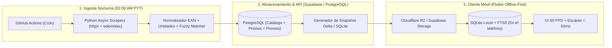

# PreciosPy — Arquitectura de Software, Estrategia de Web Scraping y Hoja de Ruta

> **Objetivo del Proyecto:** Construir la plataforma móvil más rápida, moderna y precisa de comparativa de precios de supermercados en Paraguay, diseñada bajo los principios **Offline-First**, **Zero-Latency (< 50 ms)** y **Cálculo Real de Promociones Bancarias Paraguayas**.

---

## 1. ANÁLISIS DEL TARGET (SUPERMERCADOS EN PARAGUAY)

En Paraguay, el ecosistema de e-commerce de supermercados se divide en tres arquitecturas predominantes: **monolitos ASP.NET tradicionales** (Grupo Vierci), **plataformas SaaS/Headless con APIs REST/GraphQL expuestas** (Biggie, Casa Rica, Fortis) y **plantillas e-commerce regionales** (Areté, Salemma, Los Jardines).

### 1.1 Matriz Técnica de Objetivos (Targets)

| Cadena / Tienda | URL Base | Arquitectura / Stack Detectado | Método de Extracción Ideal | Complejidad / Anti-Bot | Identificador Clave (EAN) |
| :--- | :--- | :--- | :--- | :--- | :--- |
| **Superseis** *(Retail S.A.)* | `superseis.com.py` | ASP.NET / Renderizado Híbrido (SSR + AJAX por categoría) | `httpx` + `selectolax` (HTML/AJAX) | **Baja-Media** (Rate limit básico por IP) | Presente en URL de imagen, ficha técnica o SKU interno mapeable. |
| **Stock** *(Retail S.A.)* | `stock.com.py` | ASP.NET (Mismo motor base que Superseis) | `httpx` + `selectolax` (Reutiliza el 95% del parser de Superseis) | **Baja-Media** | Comparte maestro de artículos (SKU/EAN) con Superseis. |
| **Biggie Express** | `biggie.com.py` / App API | SPA (Vue/React) consumiendo API REST JSON directa | **Intercepción directa de API JSON** (`httpx`) | **Baja** (Requiere headers de sucursal/geolocalización) | Expone el `codigoBarras` / `ean` directamente en el payload JSON. |
| **Casa Rica** | `casarica.com.py` | SSR con endpoints JSON internos de catálogo y autocompletado | `httpx` + consumo de API interna de catálogo | **Baja** | EAN visible en el objeto de producto y en las rutas de imágenes. |
| **Areté** | `arete.com.py` | E-commerce tradicional (PHP + JS paginado) | `httpx` + `selectolax` | **Baja** | Visible en el detalle de producto / atributos ocultos del DOM. |
| **Fortis Mayorista** | `fortis.com.py` | SPA / E-commerce moderno con llamadas XHR/Fetch JSON | `httpx` contra API REST de catálogo | **Media** (Precios escalonados: unitario vs. caja/mayorista) | EAN presente en el payload JSON; requiere extraer doble precio (minorista/mayorista). |
| **Los Jardines / Salemma / Real** | `losjardinesonline.com.py` / `salemmaonline.com.py` | Plataformas web estándar con paginación por `query params` | `httpx` + `selectolax` (Playwright solo como fallback) | **Baja** | SKU/EAN embebido en el DOM o imagen del producto (`.../7840012345678.jpg`). |

### 1.2 Hallazgos Críticos de Ingeniería Inversa en Retail PY
1. **Extracción de EAN sin visitar páginas individuales:** En cadenas como **Superseis, Stock, Areté y Los Jardines**, visitar cada página de producto individualmente multiplicaría por 20 el tiempo de scraping. Muchas cadenas nombran los archivos de imagen o atributos `data-sku` / `data-ean` en la grilla con el código de barras real (ej. `.../productos/7840000123456.jpg`) o exponen el catálogo por categoría en llamadas JSON.
2. **Precios por Sucursal:** Tanto **Biggie** como **Superseis/Stock** pueden variar stock y precios marginales según el centro de distribución (`branch_id` / `sucursal_id`). El scraper debe fijar por defecto una sucursal matriz de alto surtido (ej. *Superseis Hiperseis* y *Stock Mcal. López*).
3. **Pesables vs. Envasados:** Los productos de carnicería, fiambrería y verdulería usan códigos internos de balanza (prefijos `20...` o códigos cortos de 4-5 dígitos). Estos se normalizan mediante una tabla de equivalencias propia, mientras que los productos industriales se cruzan 1:1 mediante **EAN-13 / GTIN**.

---

## 2. ESTRATEGIA DE EXTRACCIÓN Y ARQUITECTURA DE DATOS (BACKEND)

Nuestro diseño desacopla el **Plano de Ingesta (Scrapers)** del **Plano de Consulta (App Móvil)**:



### 2.1 Stack Tecnológico del Scraper
* **Motor Principal:** **Python 3.12 + `asyncio` + `httpx` (HTTP/2) + `selectolax` (Lexbor en C)**.
  * `selectolax` es hasta 30x más rápido que `BeautifulSoup` y consume una fracción de RAM.
* **Fallback para SPAs complejas:** **Playwright (Headless Chromium)** únicamente si algún supermercado activa protección anti-bot o requiere hidratación compleja de sesión.
* **Validación y Normalización:** **Pydantic v2** para limpiar precios en Guaraníes (`PYG`, enteros sin decimales), extraer unidades (`KG`, `LT`, `GR`, `ML`, `UN`) y calcular el precio por unidad base (Precio por Kilo o Litro).

### 2.2 Ejecución Nocturna con GitHub Actions
Ejecución paralela mediante `strategy.matrix` a las **02:00 AM hora de Paraguay (`05:00 UTC`)**, seguida por la compilación del paquete SQLite comprimido (`.zst`) para consumo instantáneo desde los dispositivos móviles.

---

## 3. LÓGICA DE DESCUENTOS Y PROMOCIONES (TARJETAS PY)

### 3.1 Casuística Real del Mercado Bancario Paraguayo
1. **Descuento en Caja (`INSTANT_POS`) vs. Reintegro en Extracto (`CASHBACK`):**
   * distinción clara entre lo que el usuario desembolsa en el POS y el reintegro acreditado en cuenta/tarjeta.
2. **Acumulable vs. No Acumulable con ofertas de góndola (`applies_to_promo_price`):**
   * Algunos reintegros vía QR aplican sobre el monto total abonado (incluyendo ofertas de góndola), mientras que ciertos descuentos bancarios excluyen productos en oferta o aplican solo sobre `regular_price`.
3. **Topes de Compra Mensual/Diaria (`spending_cap_gs` y `max_refund_gs`):**
   * Ejemplo: *"30% de reintegro con tope de compra de Gs. 500.000 mensuales"* (Reintegro máximo = Gs. 150.000).
4. **Segmentación por Nivel / Tier:**
   * Soporte nativo para niveles (ej. *Ueno Up Nivel 1 al 5*, *Itaú Personal Bank*, *Continental*, *Atlas*, *Sudameris*, *Familiar*, *GNB*).

### 3.2 Fórmulas de Cálculo del "Precio Final Real"

$$\text{BaseElegible} = \begin{cases} \min(\text{PrecioRegular}, \text{PrecioOferta}) & \text{si } \text{applies\_to\_promo\_price} = \text{true} \\ \text{PrecioRegular} & \text{si } \text{applies\_to\_promo\_price} = \text{false} \end{cases}$$

$$\text{PrecioConTarjeta} = \text{round}\left(\text{BaseElegible} \times \left(1 - \frac{\text{discount\_pct}}{100}\right)\right)$$

$$\text{PrecioFinalReal} = \min\left(\text{PrecioRegular}, \text{PrecioOferta}, \text{PrecioConTarjeta}\right)$$

---

## 4. FRONTEND FLUIDO Y DE ALTO RENDIMIENTO (MÓVIL)

### 4.1 Por qué Flutter + Drift (SQLite FTS5) + MobileScanner
1. **60/120 FPS constantes con Impeller:** Precompilación de shaders AOT sin puente JS para listas densas de comparativas.
2. **Búsqueda local < 4 ms con SQLite FTS5 vía FFI:** Tokenizador `unicode61 remove_diacritics 2` para buscar sin acentos ni conexión a internet.
3. **Arquitectura Snapshot + Delta Diario:**
   * Catálogo completo comprimido con Zstandard (`~3 MB`).
   * Sincronización diaria de deltas (`~60 KB`) con los cambios de precios de la madrugada.

---

## 5. HOJA DE RUTA (ROADMAP) PASO A PASO

- **Fase 1 (Semanas 1-2): Cimientos, Base de Datos, Motor de Precios y Scrapers Base.**
  - Esquema PostgreSQL/Supabase completo + Semillas de supermercados y bancos de Paraguay.
  - Motor Python de normalización de unidades, extracción de EANs y cálculo de promociones bancarias (incluyendo carritos con tope de compra).
  - Spiders asíncronos modulares y workflow de GitHub Actions.
- **Fase 2 (Semanas 3-4): Entity Resolution (Unificación de Catálogo) y Exportador SQLite.**
  - Cruce automático por EAN-13 + Fuzzy Matching controlado por marca y gramaje/volumen.
  - Generador del snapshot `.db.zst` para clientes móviles.
- **Fase 3 (Semanas 5-6): App Móvil Flutter Offline-First & Escáner HUD.**
  - Integración de Drift + FTS5, billetera de tarjetas del usuario y escáner de código de barras en vivo.
- **Fase 4 (Semanas 7-8): Optimizador de "Carrito Inteligente" y Lanzamiento MVP.**
  - Simulación de carrito completo (1 solo súper vs. compra dividida respetando topes de reintegro bancario).

---

## 6. ESTRUCTURA DEL REPOSITORIO (`PreciosPy`)

```text
PreciosPy/
├── ARQUITECTURA_PRECIOSPY.md          # Este documento maestro de arquitectura
├── .github/
│   └── workflows/
│       └── nightly_scraping.yml       # Cron job 02:00 AM PYT (Matrix por supermercado)
├── database/
│   ├── schema.sql                     # DDL PostgreSQL completo (Catálogo, Ofertas, Bancos, Historial)
│   ├── seed_paraguay.sql              # Datos iniciales: Supermercados y Promociones Bancarias PY
│   └── mobile_sqlite_schema.sql       # Esquema SQLite local con índice FTS5 para la App Flutter
└── scraper/
    ├── pyproject.toml                 # Configuración de dependencias Python
    ├── src/
    │   └── precios_py/
    │       ├── __init__.py
    │       ├── models.py              # Modelos Pydantic v2 (Ofertas, Productos, Promos)
    │       ├── normalizer.py          # Normalizador de Guaraníes, EAN-13 y unidades (KG/LT)
    │       ├── promo_engine.py        # Motor de cálculo de descuentos bancarios y topes PY
    │       ├── sqlite_exporter.py     # Generador de Snapshot SQLite + FTS5 para el móvil
    │       └── spiders/
    │           ├── __init__.py
    │           ├── base.py            # Cliente HTTP/2 asíncrono con reintentos y rate-limit
    │           ├── superseis_stock.py # Spider unificado para Superseis y Stock (Retail S.A.)
    │           └── biggie.py          # Spider para API REST JSON de Biggie Express
    └── tests/
        └── test_foundation.py         # Suite de pruebas del motor de precios, normalizador y exportador
```

