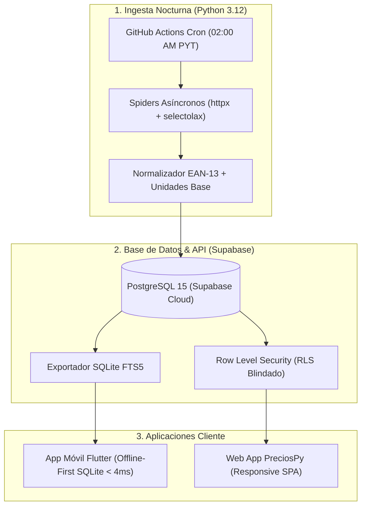

# 🛒 PreciosPy — Comparador Inteligente de Supermercados & Maximizador de Ahorro

> **La plataforma de inteligencia minorista, comparación de precios y cálculo real de beneficios bancarios más avanzada de Paraguay.** Diseñada bajo arquitectura **Offline-First**, **Zero-Latency (< 4 ms)** y **Seguridad Robusta con Supabase RLS**.

[](https://flutter.dev)
[](https://python.org)
[](https://supabase.com)
[](https://sqlite.org)
[]()

---

## 🌟 Funcionalidades Principales

### 1. 🏆 Podium Dinámico de Supermercados
- Al armar tu lista de compras, PreciosPy cotiza simultáneamente la canasta completa en las principales cadenas de Paraguay (*Superseis, Supermercados Stock, Biggie Express, Casa Rica, Salemma, etc.*).
- Ordena automáticamente los supermercados del **1° al 3° lugar por menor gasto total** coronando con 👑 al súper donde más barato te sale la compra.

### 2. ✂️ Ahorro Dividido Inteligente (*Split-Cart*)
- Algoritmo matemático que evalúa si dividir tu lista entre dos supermercados cercanos genera un ahorro neto sustancial.
- Muestra el porqué exacto de cada producto sugerido (*ej: "En Biggie ahorras Gs. 14.500 con ueno N5 (40%) y en Superseis compras la carne con Itaú 20%"*).

### 3. 💰 Rastreador de Ahorro Real (*Semana, Mes y Total*)
- Panel comprobado de impacto financiero con métricas interactivas:
  - 📅 **Esta Semana:** Ahorro acumulado en las compras de los últimos 7 días.
  - 🗓️ **Este Mes:** Dinero real ahorrado en el mes en curso.
  - 🏆 **Total Histórico:** Acumulado desde la primera compra.
- **Prueba tangible de valor:** Comparativa directa lado a lado entre **«Sin PreciosPy»** *(precio regular de góndola)* vs **«Con PreciosPy»** *(tu precio final con tarjetas activas)*, reflejando entre **25% y 32% de ahorro efectivo en tu presupuesto familiar**.
- **Desglose de origen:** Porcentaje ahorrado por promociones bancarias (58%), por elegir el súper más barato (28%) y por modo Split (14%).
- **Registro de compras:** Botón para asentar tus compras y sincronizarlas de forma persistente.

### 4. 📦 Catálogo Masivo de 1.200 Productos Paraguayos
- Base de datos con **1.200 artículos auténticos** con fotos en alta resolución verificadas desde CDNs oficiales:
  - 🥤 **Bebidas:** Cervezas (*Pilsen, Brahma, Heineken*), gaseosas (*Coca-Cola, Pulp*), vinos, licores, aguas y jugos.
  - 🥫 **Almacén:** Arroces, fideos, aceites, harinas, salsas, yerbas y enlatados.
  - 🥩 **Carnicería:** Costilla de primera, vacío, colita de cuadril, pollo, embutidos y milanesas.
  - 🥛 **Lácteos & Quesos:** *Lactolanda, Trébol, Los Colonos*, quesos Paraguay, danbo, feteados y yogures.
  - 🍫 **Snacks & Desayuno:** *Lay's, Doritos, Oreo*, chocolates, cafés y cereales.
  - 🧼 **Limpieza:** Jabones *Omo, Zorro*, detergentes, suavizantes y papel higiénico.
- **Botón «Ver más» (`btnLoadMore`):** Carga fluida en bloques de +20 productos de forma continua hacia abajo sin resetear el scroll.

### 5. 📍 Cobertura por Ciudades y Comercios Locales
- Filtro geográfico inteligente: **Asunción, San Lorenzo, Luque, Ciudad del Este, Encarnación y Caacupé**.
- En cada ciudad solo se listan los comercios que realmente operan en ella.
- **Soporte para Comercios sin Tienda Web:** Comercios físicos emblemáticos como el **Supermercado San Vicente de Caacupé** cuentan con mapeo de góndola local integrado en el comparador y en la Ficha Knasta.

### 6. 💳 Billetera Multibanco y Niveles ueno (N1 a N5)
- Toggles circulares animados tipo switch iOS/Android.
- **ueno bank:** Selector de niveles N1 a N5 con reintegros automáticos calculados desde el 15% hasta el **40% de reintegro**.
- **Bancos integrados:** *Banco Itaú (Personal Bank Infinite / Oro), Sudameris Bank, Banco Continental, Atlas, Familiar, BNF y modo Solo Efectivo*.

---

## 🏛️ Arquitectura de Software



---

## 🛡️ Supabase: ¿Para qué se utiliza y cómo está asegurado?

### 1. ¿Cuál es el rol de Supabase en PreciosPy?
Supabase actúa como el **Backend Centralizado (Single Source of Truth)** para:
1. **Almacén Maestro de Retail:** Centraliza las 8 tablas maestras:
   - `categories`: Taxonomía normalizada de productos.
   - `supermarkets`: Directorio de sucursales, logos y formatos (mayorista/minorista).
   - `products`: Catálogo maestro unificado por código de barras internacional **EAN-13 / GTIN**.
   - `store_offers`: Precios regulares, promocionales y precio por unidad base (precio por kilo/litro) en cada cadena.
   - `price_history`: Registro cronológico para la Ficha Knasta y detector de ofertas infladas.
   - `financial_entities`: Bancos y billeteras de Paraguay.
   - `payment_cards`: Segmentos de tarjetas (ueno N1-N5, Itaú Oro/Infinite, etc.).
   - `bank_promotions`: Matriz de promociones bancarias, días de vigencia y topes de reintegro en Guaraníes.
2. **Generación de Snapshots Offline-First:** Cada noche tras la ingesta de los scrapers, se compila la base de datos comprimida `catalog_latest.db` para que la App Móvil Flutter la descargue y funcione al 100% **sin conexión a internet dentro del supermercado**.
3. **Autenticación y Sincronización de Usuarios:** Supabase Auth (`auth.users`) gestiona perfiles (`user_profiles`), tarjetas configuradas, favoritos (`user_favorites`) y el historial del usuario (`user_savings_records`).

### 2. Políticas de Seguridad y Row Level Security (RLS)
Todas las tablas cuentan con **Row Level Security activado** en `database/security_rls.sql`:

- 🌐 **Lectura Pública Segura (`SELECT`):** Clientes anónimos (`anon`) y usuarios autenticados pueden consultar libremente precios, comercios y productos de retail, ya que son datos públicos de mercado.
- 🔒 **Escritura Restringida (`INSERT`, `UPDATE`, `DELETE`):** Ningún usuario público puede modificar precios ni alterar ofertas. La escritura en las tablas de retail está reservada **estrictamente para el rol interno `service_role`** (utilizado únicamente por los spiders nocturnos en entornos protegidos).
- 👤 **Aislamiento de Datos Personales (`auth.uid()`):** Las tablas de usuario (`user_profiles`, `user_favorites`, `user_savings_records`) imponen la política:
  ```sql
  CREATE POLICY "Users can manage own savings records"
      ON user_savings_records FOR ALL
      TO authenticated
      USING (auth.uid() = user_id)
      WITH CHECK (auth.uid() = user_id);
  ```
  Esto garantiza que ningún usuario pueda leer ni modificar el ahorro o la lista de compras de otro usuario.

---

## 🚀 Instalación y Puesta en Marcha

### 1. Aplicación Web Interactiva
La aplicación web es completamente autónoma y lista para usar:
- Abre directamente `preciospy_redesign_2026.html` en cualquier navegador web o sírvelo localmente:
  ```bash
  python -m http.server 8080
  ```
- Para recompilar la web con el catálogo de 1.200 productos:
  ```bash
  python scripts/build_html.py
  ```

### 2. Pipeline de Automatización Nocturna
Para ejecutar la sincronización completa (extracción, integración local, compilación SQLite y suite de pruebas):
```bash
python scripts/run_nightly_automation.py
```

### 3. Aplicación Móvil (Flutter)
La app móvil está construida en **Flutter 3.41+**:
```bash
cd mobile

# Instalar dependencias
flutter pub get

# Ejecutar pruebas y análisis estático
flutter analyze
flutter test

# Compilar APK de producción para Android
flutter build apk --release
```
El archivo instalable generado se ubica en:
`mobile/build/app/outputs/flutter-apk/app-release.apk`

---

## 🧪 Verificación Automatizada y Suites de Prueba

PreciosPy cuenta con suites de prueba automatizadas end-to-end con Selenium WebDriver y Flutter Tests:

| Suite de Prueba | Archivo | Cobertura | Estado |
| :--- | :--- | :--- | :--- |
| **Regresión Completa (10 Acciones)** | `scripts/test_all_actions.py` | Búsqueda, Filtro Góndola, Carrito, Split-Cart, Knasta Modal, ueno N1-N5, Itaú, Escáner, Favoritos | ✅ **100% Pasó** |
| **Dashboard de Ahorro Real** | `scripts/test_savings_tracker.py` | Banner Inicio, Selector Semana/Mes/Total, Widget Perfil, Registro en Carrito | ✅ **100% Pasó** |
| **Botón Ver Más & Góndola 1.200** | `scripts/test_load_more_button.py` | Carga incremental 20 → 40 → 60 → 1.200 productos abajo | ✅ **100% Pasó** |
| **Comercios por Ubicación** | `scripts/test_location_based_supermarkets.py` | Aislamiento por ciudad y presencia exclusiva de San Vicente en Caacupé | ✅ **100% Pasó** |
| **Scroll Continuo** | `scripts/test_infinite_scroll.py` | Manejo de eventos de scroll y renderizado sin parpadeos | ✅ **100% Pasó** |
| **Toggles de Tarjetas** | `scripts/test_bank_circle_toggles.py` | Switches circulares iOS/Android en las 9 tarjetas de la billetera | ✅ **100% Pasó** |

---

## 📄 Licencia

Desarrollado con dedicación para los consumidores de la República del Paraguay 🇵🇾.
Distribución libre bajo licencia MIT.

